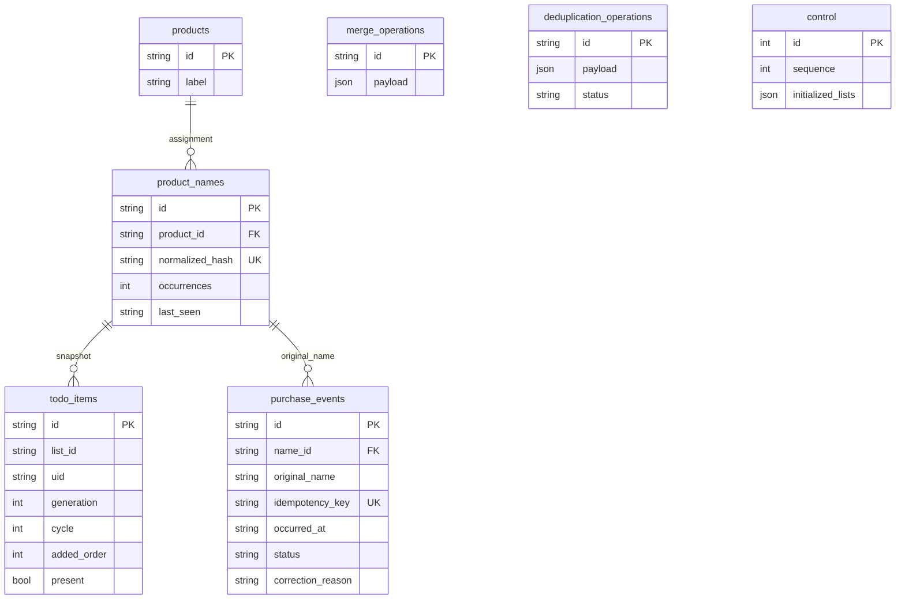

# Architecture

Public name: **pax0r's Listkeeper**. HA domain: `pax0r_listkeeper`.

## Boundaries

- `domain/`: stable identities, NFC/case/whitespace normalization, matchers and a conservative resolver. No HA or SQLAlchemy imports.
- `application/`: reconciliation, purchase cycles, corrections, name merges/moves, queries, export and explicit deletion. Ports: `ShoppingList`, `UnitOfWork`, `ProductMatcher`, `ShoppingAnalytics`.
- `infrastructure/database/`: SQLAlchemy 2 ORM, transactional state repository and Alembic. Transactions load a consistent domain state and persist changed rows in a worker thread.
- `infrastructure/ha/`: native provider validation, list reads, UID deletion, connection detection, bounded event scheduling and retries.
- `api/`: administrator-only WebSocket schemas and version 1 DTOs.
- `frontend/`: local Web Components, API transport, presentation helpers and language dictionaries.

## Data model

Tables use prefix `pax0r_listkeeper_`; PostgreSQL also uses schema `pax0r_listkeeper`. Events reference names, so reassignment changes historical statistics without rewriting events. Empty products remain for identity preservation but are hidden from the dashboard.

`normalized_hash` is SHA-256 of the normalized name, avoiding MySQL collation and index-length differences. A collision fails the transaction rather than causing an automatic merge.

## Transactions and recovery

1. Read the current HA list.
2. Commit snapshots, purchases/corrections and deletion intents in one SQL transaction.
3. Validate current name assignments, complete list content, UIDs and survivor status.
4. Recheck immediately before calling the native entity's UID-specific deletion method.
5. Acknowledge the operation in SQL. Missing victim UID identifies a crash after deletion but before acknowledgement.

HA and SQL do not share a distributed transaction. List edits or split names supersede stale intents. Logs are retained indefinitely. Multiple duplicates converge through subsequent self-generated events; list changes invalidate remaining stale intents.

A runtime gate serializes synchronization and panel mutations, a reconciliation lock protects list processing, and UoW serializes SQL with a control-row lock where `FOR UPDATE` is available. One config entry prevents competing instances within HA. Do not connect independent HA installations to the same owned tables.

## History and analytics

Initial reconciliation establishes a baseline. Observed active → completed transitions create events keyed by snapshot identity, UID generation and purchase cycle. Unchecking starts another cycle. Corrections within 60 minutes inclusive set `cancelled` and `quick_uncheck`, requiring reliable observations of both transitions.

After downtime, a known active item found completed produces a `recovery` event at detection time. Newly discovered completed items have no observed transition. Intermediate changes are not reconstructed; unknown uncheck times never cancel purchases.

Timestamps are UTC ISO-8601 strings. HA's timezone determines unique purchase days per product; no SQL uniqueness constraint exists on product/day. Frequency uses consecutive unique dates across full history. Counts and displayed purchase dates respect the selected period.

## Migrations and scaling

Alembic `001` creates tables; `002` adds indexes. Revisions freeze their DDL independently of current ORM models. Upgrades are additive; downgrades are blocked. MySQL DDL can be nontransactional, so retries check for existing tables and indexes. Back up SQL before upgrades.

The MVP loads complete integration state per transaction. Cost grows with retained history; large archives require profiled selective repositories and paginated exports. There is no automatic purge.
