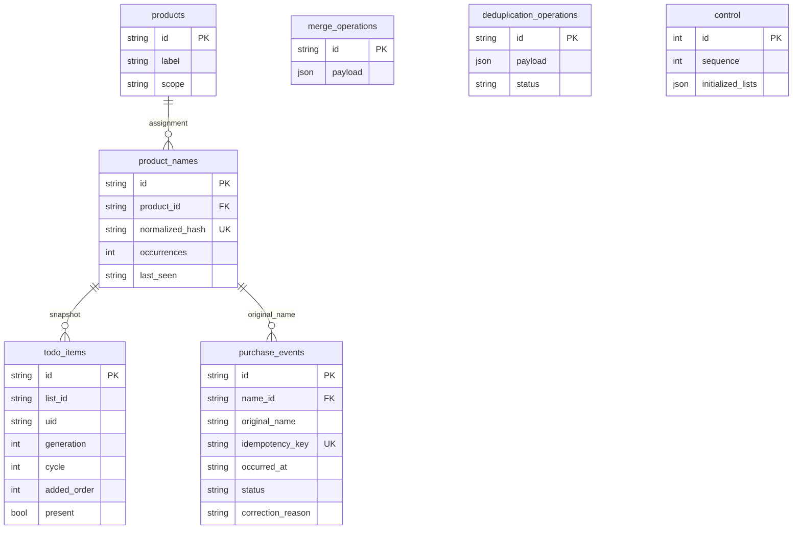

# Architecture

Public name: **pax0r's Listkeeper**. HA domain: `pax0r_listkeeper`.

## Boundaries

- `domain/`: stable identities, NFC catalog normalization, accent/case/whitespace-insensitive matching and duplicate resolution. No HA or SQLAlchemy imports.
- `application/`: reconciliation, purchase cycles, corrections, name merges/moves, queries, export and explicit deletion. Ports: `ShoppingList`, `UnitOfWork`, `ProductMatcher`, `ShoppingAnalytics`.
- `infrastructure/database/`: SQLAlchemy 2 ORM, transactional state repository and Alembic. Transactions load a consistent domain state and persist changed rows in a worker thread.
- `infrastructure/ha/`: Shopping List/Local To-do validation, list reads, UID deletion, connection detection, independent list runtimes, bounded event scheduling and retries.
- `api/`: administrator-only WebSocket schemas and version 1 DTOs.
- `frontend/`: local Web Components, API transport, presentation helpers and language dictionaries.

## Data model

Tables use prefix `pax0r_listkeeper_`; PostgreSQL also uses schema `pax0r_listkeeper`. Events reference names, so reassignment changes historical statistics without rewriting events. Empty products remain for identity preservation but are hidden from the dashboard.

`normalized_hash` is SHA-256 of the list scope, a NUL separator and the normalized name, avoiding MySQL collation and index-length differences while allowing the same spelling on multiple lists. Legacy unscoped records retain the old hash until assigned a scope. A collision fails the transaction rather than causing an automatic merge.

## List contexts

One config entry stores an opt-in `entity_ids` selection. A runtime collection creates one independently locked/listened runtime per selected entity and owns the shared SQL pool. The application `ListUnitOfWork` provides a transactional view containing only products owned by that entity, their names, list snapshots, purchase events and decision logs. Mutations are applied back within the parent transaction; deleting one view cannot delete another. Names and products cannot be moved between scopes.

The panel retrieves enabled lists through `pax0r_listkeeper/get_lists` and sends `entity_id` with every contextual command. Multiple enabled lists require an explicit context; omitted context remains supported for exactly one enabled list. Unknown or opted-out entities are rejected. Export identifies its list explicitly. UI context changes clear selected IDs, pending dialogs and history pagination.

Entity IDs are scope identifiers in this release. Friendly-name changes do not affect ownership; entity-ID changes do. Deselecting a list removes its runtime/listeners without purging SQL. Empty selection starts no list runtimes. Unavailable configured entities can recover through their own retry/state listeners without suspending healthy lists.

## Transactions and recovery

1. Read the current HA list.
2. Commit snapshots, purchases/corrections and deletion intents in one SQL transaction.
3. Validate current name assignments, complete list content, UIDs and survivor status.
4. Recheck immediately before calling the native entity's UID-specific deletion method.
5. Acknowledge the operation in SQL. Missing victim UID identifies a crash after deletion but before acknowledgement.

HA and SQL do not share a distributed transaction. List edits or split names supersede stale intents. Logs are retained indefinitely. Each batch intent expects the snapshot remaining after preceding deletions, allowing multiple duplicates to be removed in one pass. Partial failures remain recoverable; unrelated list changes invalidate stale intents.

Resolution keeps an active entry if one exists, otherwise a completed entry. The latest first observation, known addition order and stable UID determine the survivor within that status. Unknown creation order does not prevent cleanup; no creation timestamp is inferred. Purchases are committed before any deletion, including completed-only groups.

Catalog normalized strings remain unchanged for storage compatibility. A separate matching key removes combining marks and folds Polish `ł` to `l`, preserving digits, units and punctuation. Reconciliation transactionally joins product identities sharing a matching key within the current list and logs `normalize_names` decisions; it never rewrites purchase or original name IDs. Existing aliases follow their product into that group.

A runtime gate serializes synchronization and panel mutations, a reconciliation lock protects list processing, and UoW serializes SQL with a control-row lock where `FOR UPDATE` is available. One config entry prevents competing instances within HA. Do not connect independent HA installations to the same owned tables.

## History and analytics

Initial reconciliation establishes a baseline. Observed active → completed transitions create events keyed by snapshot identity, UID generation and purchase cycle. Unchecking starts another cycle. Corrections within 60 minutes inclusive set `cancelled` and `quick_uncheck`, requiring reliable observations of both transitions.

After downtime, a known active item found completed produces a `recovery` event at detection time. Newly discovered completed items have no observed transition. Intermediate changes are not reconstructed; unknown uncheck times never cancel purchases.

Timestamps are UTC ISO-8601 strings. HA's timezone determines unique purchase days per product; no SQL uniqueness constraint exists on product/day. Frequency uses consecutive unique dates across full history. Counts and displayed purchase dates respect the selected period.

## Migrations and scaling

Alembic `001` creates tables; `002` adds indexes; `003` adds indexed product scope. Revisions freeze their DDL independently of current ORM models. Upgrades are additive; downgrades are blocked. MySQL DDL can be nontransactional, so retries check for existing tables, columns and indexes. Back up SQL before upgrades.

Config-entry migration retains the old selected entity as the legacy catalog owner. Scope assignment and hash updates run in a transaction, preserving original catalog and purchase IDs. Older shared histories remain together in that context; snapshots from other previously selected lists get new scoped catalog references for future processing. With a detached legacy database, a single stored list can identify the owner automatically; ambiguous ownership fails safely rather than guessing.

The MVP loads complete integration state per transaction. Cost grows with retained history; large archives require profiled selective repositories and paginated exports. There is no automatic purge.
